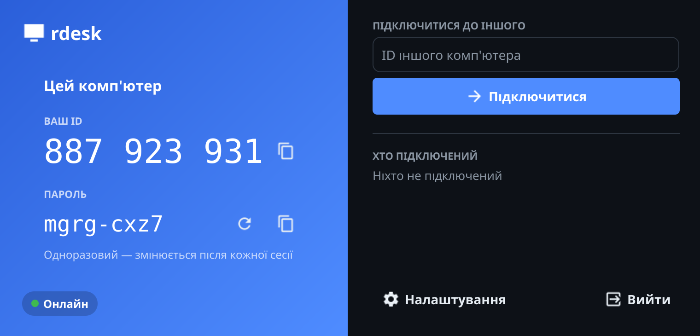

# rdesk

Власний легкий віддалений робочий стіл замість AnyDesk / TeamViewer.

- **Хост** (`rdesk`) — один бінарник на машині, до якої підключаються: захоплює
  екран, кодує H.264 (OpenH264, статично вшитий), передає системний звук (Opus),
  вводить мишу й клавіатуру, синхронізує буфер обміну, приймає/віддає файли.
- **Переглядач** — у браузері, нічого встановлювати не треба: відкрити
  `https://<сервер>/`, ввести ID і пароль.
- **Сервер** (`rdesk-server`) — один статичний бінарник / Docker-образ на 8 МБ:
  WebSocket-сигналінг, вбудований TURN/STUN-relay (pion/turn) і сторінка
  переглядача. Без бази даних.

З'єднання — WebRTC: спершу пряме P2P (через NAT, без проброса портів, за
допомогою STUN), а якщо не вийшло — через TURN-relay сервера. Відео, звук і дані
завжди шифровані DTLS/SRTP наскрізно між хостом і переглядачем; сервер бачить
лише сигналінг.

```
 переглядач (браузер) ──wss──┐            ┌──wss── хост (rdesk)
                             ▼            ▼
                        rdesk-server (сигналінг + TURN)
 переглядач ◀════════ WebRTC: P2P або через TURN ════════▶ хост
```

## Автентифікація

Хост реєструється під **ID** (9 цифр), який виводиться з його секретного токена
(`~/.config/rdesk/config.json`) — зайняти чужий ID без токена неможливо.

Пароль — **одноразовий код** `xxxx-xxxx`, який хост показує в консолі. Він
змінюється після кожної завершеної сесії та після 5 невдалих спроб. Для
підключення без людини біля хоста можна задати постійний пароль:
`rdesk -password 'довгий-пароль'` (запам'ятовується; `-password -` прибирає).

Пароль **ніколи не передається мережею**. Після встановлення WebRTC-з'єднання
хост надсилає nonce, а переглядач і хост обмінюються HMAC-SHA256 від пароля,
nonce та DTLS-відбитків обох сторін. Тому навіть скомпрометований сигнальний
сервер, що спробує підмінити SDP (людина посередині), не пройде перевірку — і
переглядач теж перевіряє, що хост справжній. Сервер обмежує частоту спроб
підключення до кожного ID та з кожної IP-адреси.

Відео/звук не передаються, а ввід ігнорується, доки переглядач не пройшов
автентифікацію.

## Запуск

### Хост

Просто запустіть `rdesk` — відкриється вікно:



Ліворуч — ID і одноразовий пароль цього комп'ютера (кнопки копіювання й нового
пароля), праворуч — підключення до іншого комп'ютера (відкриває переглядач у
браузері) і список тих, хто підключений, з кнопкою «Від'єднати». У налаштуваннях —
сервер, постійний пароль, режим «лише перегляд» і звук. Коли хтось підключається,
вікно з'являється й показує системне сповіщення. На Windows і macOS закриття
вікна ховає rdesk у трей; на Linux — питає, чи вийти.

Без вікна (сервер, SSH, автозапуск): `rdesk -headless` друкує ID і пароль у
консоль. Сервер за замовчуванням — `https://rdesk.romanovich.dev`; інший задається
в налаштуваннях або `-server URL` (запам'ятовується). Корисні прапорці:

| прапорець | за замовчуванням | що робить |
|---|---|---|
| `-headless` | — | без вікна, ID і пароль у консоль |
| `-password` | — | постійний пароль (≥ 8 символів), `-` — повернути одноразові коди |
| `-display N` | `0` | який монітор показувати (`-list-displays`); на Linux `-1` — усі |
| `-fps` | `30` | максимум кадрів за секунду |
| `-bitrate` | `6000` | стеля бітрейту, кбіт/с (реальний підлаштовується під канал, GCC) |
| `-max-width` | `2560` | ширші екрани зменшуються в ціле число разів |
| `-no-audio` | — | не передавати звук |
| `-audio-device` | авто | частина назви пристрою захоплення звуку |
| `-view-only` | — | лише перегляд, без керування |
| `-downloads` | `~/Downloads/rdesk` | куди складати файли від переглядача |

### Переглядач

Відкрийте `https://rdesk.romanovich.dev/#<ID>` (посилання друкує хост), введіть
пароль. На панелі зверху: масштаб, повний екран (у Chromium захоплює й Alt+Tab,
Win тощо), Ctrl+Alt+Del, файли, звук, від'єднання. Файли можна просто
перетягнути на екран. Буфер обміну синхронізується в обидва боки (браузер один
раз спитає дозвіл на читання буфера). Тексти, які менеджери паролів позначають
як чутливі, хост не пересилає.

`?relay=1` в адресі примусово веде трафік через TURN (для перевірки relay).

### Сервер

Docker (продакшн-конфіг під спільну інфраструктуру `~/Personal/infra`: власного
postgres/redis/caddy немає, HTTP іде через caddy-docker-proxy за мітками):

```bash
cp deploy/rdesk.env.example deploy/rdesk.env   # RDESK_TURN_SECRET, RDESK_PUBLIC_IP
docker compose --project-directory . -f deploy/compose.yaml up -d --build
```

Порти, які мають бути доступні ззовні напряму (не через Caddy): **3479/udp,
3479/tcp** (STUN/TURN) і **49400–49460/udp** (relay). Relay не пропускає трафік до
приватних і loopback-адрес, тож його не можна використати для доступу до
внутрішніх сервісів сервера.

Без Docker: `rdesk-server -public-ip <IPv4> -turn-secret <секрет>` і TLS-проксі
перед `:8080` (браузерам потрібен HTTPS для WebCrypto).

Локально (через спільний Caddy на `https://rdesk.localhost`):

```bash
docker compose -f docker-compose.local.yml up -d --build
./bin/rdesk -server https://rdesk.localhost
```

## Збірка

Потрібен **Go 1.27+** і C-компілятор (cgo: захоплення екрана, ввід, кодеки).
OpenH264 і Opus уже вшиті статичними бібліотеками з `pion/mediadevices`, окремо
їх ставити не треба. Сервер збирається без cgo для будь-якої платформи.

### Linux (x86_64 / arm64)

```bash
sudo apt install gcc g++ libx11-dev libxext-dev libxtst-dev \
  libgl1-mesa-dev libxcursor-dev libxrandr-dev libxinerama-dev libxi-dev libxxf86vm-dev
go build -trimpath -ldflags="-s -w" -o bin/rdesk ./cmd/rdesk
```

Під час роботи потрібні лише libX11/libXext/libXtst (є на будь-якому десктопі з
X11) і PulseAudio/PipeWire для звуку (береться monitor-джерело виходу за
замовчуванням).

### macOS (Apple Silicon / Intel)

```bash
xcode-select --install
go build -trimpath -ldflags="-s -w" -o bin/rdesk ./cmd/rdesk
```

Під час першого запуску macOS попросить дозволи (System Settings → Privacy &
Security): **Screen & System Audio Recording** (екран) і **Accessibility**
(миша/клавіатура) — для Terminal або для самого `rdesk`; після надання
перезапустіть `rdesk`. macOS не дає захоплювати системний звук без віртуального
пристрою: встановіть [BlackHole](https://github.com/ExistentialAudio/BlackHole),
спрямуйте на нього вивід (або Multi-Output Device), і `rdesk` знайде його сам.

### Windows (x64)

Потрібен MinGW-w64 GCC, найпростіше — [MSYS2](https://www.msys2.org/):

```bash
pacman -S mingw-w64-x86_64-gcc
```

Далі в терміналі **MSYS2 MINGW64** (або в будь-якому, де `gcc` з MinGW у `PATH`):

```bash
CGO_ENABLED=1 go build -trimpath -ldflags="-s -w -H windowsgui -extldflags=-static" -o bin/rdesk.exe ./cmd/rdesk
```

`-extldflags=-static` вшиває libstdc++/libgcc, тож `rdesk.exe` не тягне DLL з
MinGW. Звук береться WASAPI loopback з виходу за замовчуванням.

Або крос-збіркою з Linux (потрібен лише Docker):

```bash
./scripts/build-windows.sh   # → bin/rdesk.exe, імпортує тільки KERNEL32.dll і msvcrt.dll
```

### Сервер

```bash
CGO_ENABLED=0 go build -trimpath -ldflags="-s -w" -o bin/rdesk-server ./cmd/rdesk-server
```

### CI

`.github/workflows/build.yml` збирає хост нативно на Linux, macOS (arm64 і
x64) і Windows та сервер для linux/amd64+arm64 — артефакти з'являються на
сторінці запуску. macOS-збірку інакше не перевірити: для неї потрібні Apple SDK
і Mac (або macOS-раннер GitHub).

## Обмеження MVP

- **Wayland** поки не підтримується: хост на Linux потребує X11-сесії (на
  екрані входу — «Xorg»/«X11»). Підтримка через xdg-desktop-portal + PipeWire
  запланована.
- **Windows:** захищений робочий стіл (UAC-запити, екран блокування) не
  захоплюється, а Ctrl+Alt+Del не можна відправити через SendInput; щоб керувати
  вікнами, запущеними від адміністратора, запустіть `rdesk` від адміністратора.
  Служби Windows (робота до входу в систему) поки немає.
- Курсор віддаленої машини не малюється у відео: видно локальний курсор
  браузера.
- Один монітор за раз (вибір прапорцем `-display`).
- Збирання і запуск перевірено на Linux (X11). Windows-хост збирається
  (крос-компіляція MinGW), але на справжній Windows ще не запускався. macOS-код
  ще жодного разу не компілювався — перша збірка в CI покаже.

## Розробка

```bash
go test ./...                      # юніт-тести, в т.ч. звірка HMAC з переглядачем
go test ./internal/host -bench .   # швидкодія конвертації та кодування
```

Структура:

```
cmd/rdesk          хост-агент
cmd/rdesk-server   сервер
internal/host      сесії WebRTC, конвеєри відео/звуку, файли, буфер обміну
internal/capture   захоплення екрана (X11 XShm; GDI/ScreenCaptureKit через kbinani/screenshot)
internal/input     ввід (XTest, SendInput, CGEvent) і таблиця клавіш KeyboardEvent.code
internal/auth      взаємна автентифікація паролем
internal/gui       вікно (Fyne); RDESK_SNAPSHOT_DIR=… go test ./internal/gui малює його в PNG
internal/server    сигналінг, TURN, ліміти
web/static         браузерний переглядач (без залежностей)
deploy/            Dockerfile і compose для сервера
```
